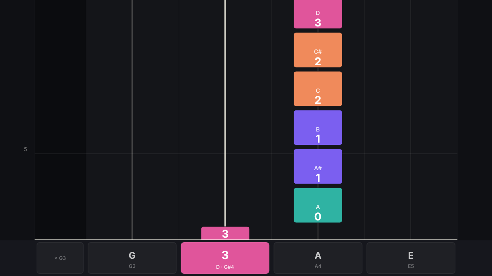

# Sightread-violin

Um fork do [Sightread](https://github.com/sightread/sightread) com uma visualização feita para **tocar violino**: as notas caem sobre as quatro cordas (Sol, Ré, Lá, Mi), no lugar das teclas do piano, e cada bloco mostra o dedo a usar.



> **Aviso**
> - Ferramenta de **uso pessoal**, sem garantias, feita para estudar violino lendo as notas caindo.
> - O código deste fork foi escrito **100% com IA** ([Claude](https://claude.ai), da Anthropic), que aparece como coautor nos commits.
> - Não é afiliado ao projeto Sightread original.

## Como funciona a visão de violino

- **Cordas:** cada corda toca a própria nota solta e até **6 semitons** acima dela (1ª posição, sem lacunas entre as cordas):

  | Corda | Notas |
  |---|---|
  | Sol (G3) | G3 – C♯4 |
  | Ré (D4) | D4 – G♯4 |
  | Lá (A4) | A4 – D♯5 |
  | Mi (E5) | E5 – A♯5 |

- **Dedos:** o número dentro do bloco é o dedo. 0 é a corda solta, 1–2 semitons usam o 1º dedo, 3–4 o 2º e 5–6 o 3º. A cor também indica o dedo: verde = solta, roxo = 1, laranja = 2, rosa = 3.
- **Fora da extensão:**
  - Notas abaixo de G3 não existem no violino. Elas aparecem em cinza numa faixa à esquerda das cordas, o que ajuda a perceber um MIDI na oitava errada (use *Transpose* nas configurações).
  - Notas acima de A♯5 aparecem em cinza na corda Mi, onde seriam tocadas em posições mais altas.
- **Painel inferior:** acende a corda que está soando, com o dedo e a nota.
- O nome das notas segue a opção *Note labels* (None / Alphabetical / Fixed Do).
- Todo o resto do Sightread continua funcionando: velocidade, loop, metrônomo, seleção de faixas e espera.

A visão de violino é a padrão. Para trocar de visão, use o menu *Visualizer* nas configurações ou o atalho `Shift + '`, que alterna entre violino, piano e partitura.

### Mudando as regras

Todas as regras ficam em [`src/features/violin/config.ts`](src/features/violin/config.ts):

- `maxSemitones` de cada corda define até onde ela toca. Com 7, o 4º dedo vira alternativa à corda solta seguinte e a corda solta é a preferida.
- `fingerBySemitone` define qual dedo usar para cada semitom.
- `belowRange` (`'lane'` ou `'discard'`) e `aboveRange` (`'top-string'`, `'lane'` ou `'discard'`) definem o que fazer com notas fora da extensão.

A decisão de corda/dedo está em [`placement.ts`](src/features/violin/placement.ts), com testes. O desenho está em [`src/features/SongVisualization/violin.ts`](src/features/SongVisualization/violin.ts).

## Rodando localmente

Requer [Bun](https://bun.sh).

```bash
bun install
bun dev        # baixa os soundfonts na primeira vez e abre em http://localhost:5173
```

Para usar suas músicas, abra *Songs* e adicione uma pasta com arquivos `.mid`.

Outros comandos:

```bash
bun test                                   # testes
bun run build                              # build de produção (Analytics só se VITE_PUBLIC_GA_ID estiver definido)
bun scripts/snapshot-violin.ts musica.mid  # salva quadros da visão de violino em PNG (sem navegador)
```

Para o `snapshot-violin.ts` funcionar, rode antes `(cd node_modules/skia-canvas && node lib/prebuild.mjs download)`.

## Créditos e licença

Baseado no [Sightread](https://github.com/sightread/sightread) (commit `3836a79`), de Jake Fried e colaboradores. Assim como o original, este projeto é distribuído sob a licença **GNU GPL v3.0** (veja [LICENSE](LICENSE)).
